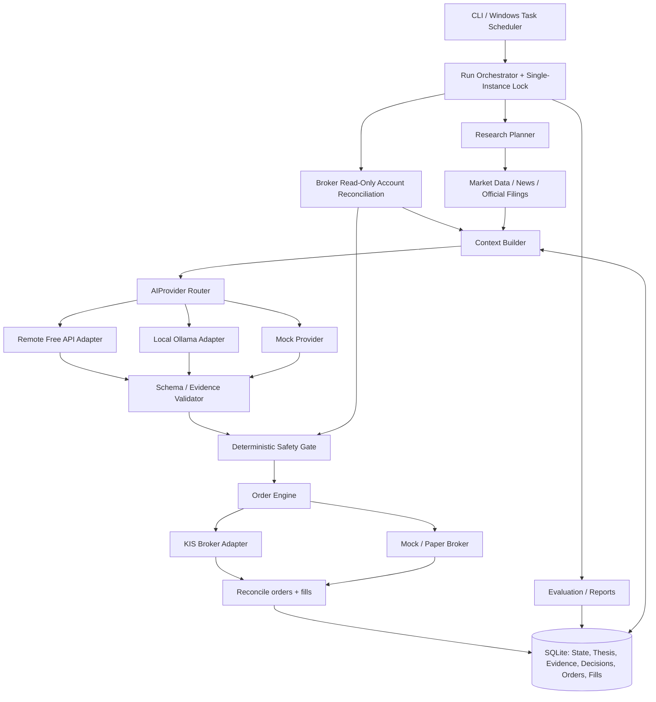
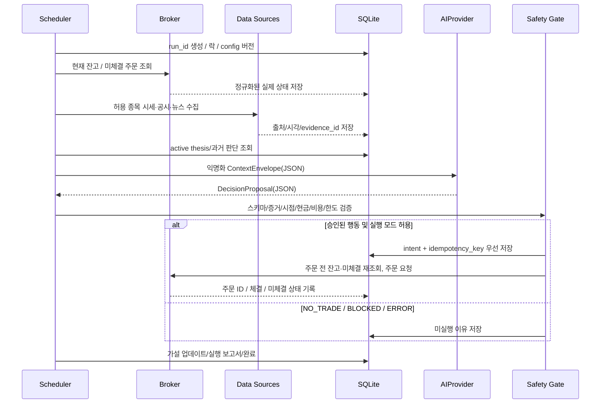
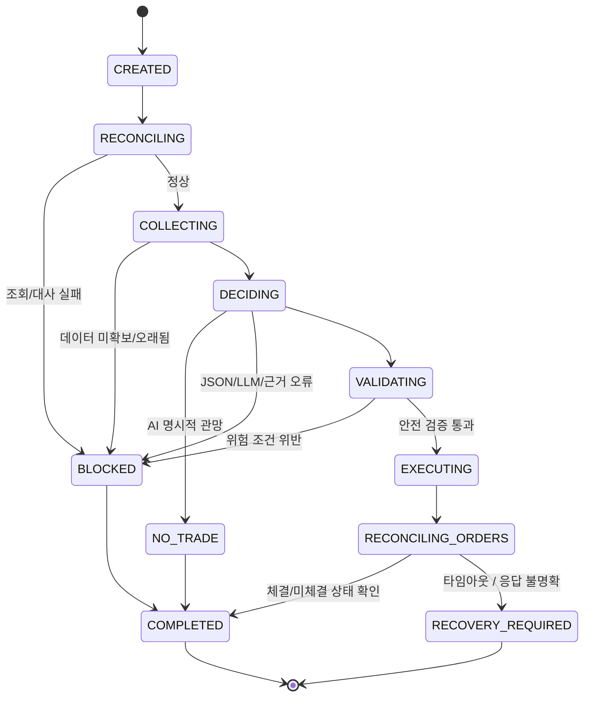

# 01 — 아키텍처와 운영 상태 기계

## A. 컴포넌트 구조 (개발 기준)

`AIProvider`에는 주문 도구·계좌 인증정보·파일시스템/명령실행 권한을 주지 않는다. 시장 데이터 취득은 검증된 도구 목록을 호출하는 **파이썬 코드**가 수행한다. AI는 계획이나 요약을 제안할 수 있지만 임의의 HTTP/쉘 명령을 직접 실행하지 않는다.

## B. 런타임 분리
- **Control Plane**: CLI, 사용자 설정, 모드·권한·킬스위치, 스케줄.
- **Data Plane**: KIS 가격/잔고·주문조회, 공시·뉴스, 분석 지표, 시각 정합성.
- **Reasoning Plane**: LLM 후보 교체 및 기록·가설 관리, 구조화된 `DecisionProposal` 출력.
- **Execution Plane**: `OrderIntent`의 별도 검증·idempotency·KIS 주문/조회·부분체결 복구.
- **Evaluation Plane**: 비용과 현금흐름을 반영한 공정 성과 측정.

## C. 1회 실행 파이프라인

## D. 스케줄과 PC 종료
- Windows Task Scheduler를 우선 사용한다. `invest run-once`는 단일 작업을 동기적으로 완료하고 종료하며 **동시에 2회 실행 불가**.
- `every N minutes`는 운영 예약 간격일 뿐, 분석 N분 내 강제 완료/거래 매회 수행 강제 아님. 실행시간 한도 초과 시 안전하게 분석 중단; 이미 주문 요청이 전송됐다면 **주문 조회·체결 확인은 중단 없이 복구 경로에 위임**.
- 두 번째 트리거가 기존 실행과 겹치면 `SKIPPED_ALREADY_RUNNING`으로 기록. 뒤늦게 밀린 거래를 중복 실행하지 않음.
- 재부팅 후 `RECOVERING`으로 진입; 주문 복제 재전송 금지. KIS 계좌/주문/미체결부터 대조.
- PC 종료 중 AI도 주문 엔진도 실행되지 않음. 외부 API를 쓰는 것만으로 상시 운영이 되는 것이 아님. 모바일 단독 실행과 클라우드 무인 실행은 초기 미지원.

## E. Run 상태 기계

`NO_TRADE` = AI의 정상적인 전략 판단. `BLOCKED` = 데이터/안전/시스템 문제로 거래 불허. `RECOVERY_REQUIRED` = 이미 주문이 나갔을 가능성이 있어 재조회가 먼저 필요한 위험 상태. 상태는 UI/DB에서 반드시 구분.

## F. 책임·소유권
- 잔고/체결 원본의 최종 근거: **KIS 조회 결과**.
- 영속 투자 가설, 관심상품, 사용자 설정, AI 판단 기록의 근거: **로컬 SQLite**.
- 시장 데이터 최신성: 각 원천 시스템의 관측시각과 데이터 조정 처리.
- API 호출 성공은 체결을 뜻하지 않음. 체결 여부는 주문조회/체결조회 결과로 확정.
- SQLite가 지워지거나 손상됐을 때 **KIS로 복구 가능한 계좌/주문 정보**와 **복구 불가능할 수 있는 AI 가설/평가 기록**을 구별. 매일 로컬 백업.

## G. 기능 확장 지점
`Broker`/`AIProvider`/`EvidenceSource`/`ExecutionMode`는 각각 독립 인터페이스. 추가 공급자는 코어 코드를 수정하지 않고 등록·설정만으로 전환할 수 있도록 계약 테스트를 준수.
