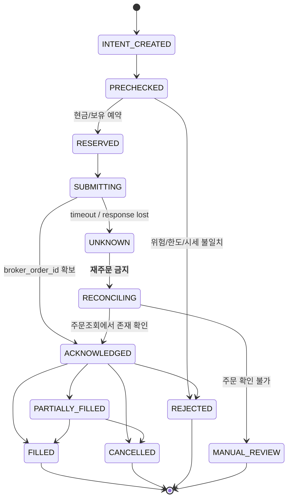

# 06 — 주문 실행·리스크·현금·중복/장애 복구 계약

## A. 신뢰 경계
LLM의 `DecisionProposal`은 **주문이 아니다**. 주문은 오직 `RiskGate`가 통과시켜 생성한 `ValidatedOrder`만 `BrokerTrade`에 전달할 수 있다. `AIProvider`와 연구 도구는 주문 어댑터를 import/참조하지 않는다.

## B. 필수 안전조건 (`LIVE`뿐 아니라 모의에서 테스트)
1. 사용자 선택된 시장(KRX/US) 활성 상태 및 명시 허용한 종목인지.
2. 자산 분류는 주식·ETF 현물/검증 채권, `is_leveraged`/inverse/restricted 기본 차단. 신용·미수·대출·공매도·선물옵션 요청 전면 거부.
3. KIS 실제 계좌의 **주문 가능한 현금**을 기준으로 총액 한도 계산. 기존 미체결 매수분의 예약 현금·환전 비용·예상 수수료·세금 반영. 현금이 충분하지 않으면 거절하거나 한도 내 축소(축소 사유 기록). 잔고/체결 정보 조회 실패 시 즉시 차단.
4. 보유하지 않은 물량을 SELL하려 하면 거절. 미체결 매도에서 예약된 물량도 차감.
5. 시장 개장·거래일·거래 세션·장전/장후/휴장 주문 정책 검증. **초기 정규장만 허용**, 미국 DST 반영. 장외 거래는 별도 작업으로.
6. bid/ask·시세 관측시각·환율·유동성/거래 단위·호가단위 검증. 시세 freshness 임계값은 공식 데이터 유형별 설정(초기 모의 예: 정규장 60초 이내 권장값, **검증 전 실거래 기본 차단**). 장종료의 종가로 장중 시장가 주문 계산 금지.
7. 자기 자본 안에서 투자가 가능한 한 AI가 현금 0~100% 자율 선택하되, 실거래 주문/일·계좌 보호 하드캡은 사용자 승인 전 미설정→`LIVE_BLOCKED`.
8. 원격 무료 API 사용 시 개인 실거래 사용권한과 데이터 처리 조건 검증되지 않으면 `LIVE_BLOCKED`.
9. 거래 비용 추정치(수수료, 세금, 스프레드, 환전 비용)가 기록되지 않았거나 상품별 비용 모델이 미확인인 경우 신규 실주문 금지. 추정값이 0이라고 결론 내지 말 것.
10. `kill_switch` 활성화 시 신규 주문/자동 재시도 금지. 기존 주문 체결/위험은 계속될 수 있으므로 확인 경고와 미체결 상태 별도 표기.

## C. 금전 계산과 주문 수량
- Decimal 사용. `max_affordable_qty = floor_to_lot((available_cash - reserved - fees - buffer)/estimated_unit_cost)`; currency별 개별 계산.
- 매매 요청은 목표 비중(`target_weight_bps`)에서 계산하되 금액·보유 수량·미체결·통화별 가용 현금과 KIS 주문 가능 수량을 마지막에 재검증.
- 매도는 목표비중 대비 감소분만. 기존 타계좌 보유를 이 계좌 자본으로 계산 금지.
- 주문단위는 상품·거래소마다 다름; 공식 문서 확인 전 미국 소수점 주문 지원 가정 금지. 채권은 단위/호가/경과이자/수수료가 주식과 달라 별도 주문 구현.
- `ALLOW_MARKET_ORDER=false` 초기: 검증 가능한 지정가 주문만 사용(시장/상품별 공식 지원 확인). 시장가가 필요한 경우 실거래 허용 전에 가격 보호·체결 특성 검증.
- 체결·가치·원장은 통화 구분: KRW/US$를 단순 더하면 잘못된 포트폴리오 수익률. FX 기초율과 시각 기록.

## D. 주문 상태 기계

- API 요청 성공/접수는 체결이 아님. 부분체결 시 수량별 수수료·평균체결가와 현금·예약을 올바르게 조정.
- `idempotency_key = hash(account_alias, mode, run_id, decision_id, asset_id, side, target_version)` 등 일관된 결정 필드 기반. DB UNIQUE 후 **주문 요청 전에 INSERT/RESERVE**. 원장 트랜잭션 완료 전 실제 주문 발송 금지.
- 단, KIS 주문 API의 별도 client-provided idempotency 보장이 확인되지 않는다면 로컬 키만으로 네트워크 장애 시 중복 100% 방지는 어려움. 따라서 **미확정 응답에서 재전송 금지, 조회 대사 후 불확실하면 사람의 확인 필요**가 기본.
- 장애 복구 시 실제 주문 미체결 조회를 우선, `UNKNOWN`/`RECOVERY_REQUIRED`가 있으면 신규 매수 전체 차단(또는 같은 자산 차단). 사유를 CLI에 명시.

## E. 장애·연속 손실
| 상황 | 신규 주문 | 처리 |
|---|---|---|
| OpenAI 호환 LLM 429/빈 답변 | 없음 | `AI_UNAVAILABLE`, fallback 가능하나 최신 상태로 재판단 |
| 자료 출처 없음/가격 오래됨 | 없음 | `DATA_STALE` |
| KIS 토큰 만료 | 없음 | 안전한 재발급 후 조회, 무분별 재주문 금지 |
| 주문 응답 timeout | 없음 | `UNKNOWN` 후 주문조회/대사 |
| 주문 부분체결 | 신규 주문은 보유/예약 재계산 후 판단 | 일부만 장부 반영 |
| 로컬 PC 강제 종료 | 없음 | 재부팅 후 `recover` 우선 |
| 동시 실행 | 없음 | 기존 작업만 수행, 중복 trigger SKIPPED |
| 의심스러운 폭주·중복 주문 | 없음 | kill switch 및 경보 |
| 일 손실 보호 한도 초과 | 신규 매수 차단 | 사용자가 정의한 보호 정책에 따라 별도 처리. 손실 상한을 보장하지 못함 |
| KRX 휴장/US 개장 | KRX 없음 | US만 독립 실행 가능 |
| 매매 가능 종목 없음 | 없음 | 의도적 정상 NO_TRADE |

## F. 실거래 시작 승인 게이트
- 인증키/계좌 API 연결 실제로 확인; 주문 가능 상품·거래시간·최소수량·환전 경로 검증.
- 정상 모의 주문/취소/체결과 timeout/부분체결/중복주문/재시작 후 대사까지 통과.
- 실행 가능한 하드캡(단일 주문 최대, 종목/계좌 노출, 일 손실 중지, 허용 상품) 구체 숫자를 사용자에게서 받고 설정·테스트.
- 개인 투자 실험에 쓸 AI API 이용약관을 검증하고 `LICENSE_VERIFIED_FOR_LIVE=true`를 검토·증빙 후 설정 (추정 금지).
- 사용자가 먼저 로컬에서 `live-unlock` (나중 단계에서 구현) 명시적 제어. `LIVE` 계좌·키·host·mode를 코드가 분리 검사.
- 최초 실주문은 실제 거래소·소액 주문 1건을 사용자 입회 하에 시험. 권한 승인 없으면 구현 테스트는 Mock/PAPER만.

## G. 보호 정책의 한계
- API 초당 한도, 지정가, 손절 주문, 킬스위치 어느 것도 손실 상한을 **확정적으로 보장하지 않는다**. PC가 꺼져 있을 때 미체결 주문이 체결될 수 있으며, 즉시 대응이 불가능할 수 있다.
- 초기 사용자는 작은 현금 현물 포지션만 허용하며, 24시간 무인 위험 보호를 구현했다고 주장하지 않는다.
